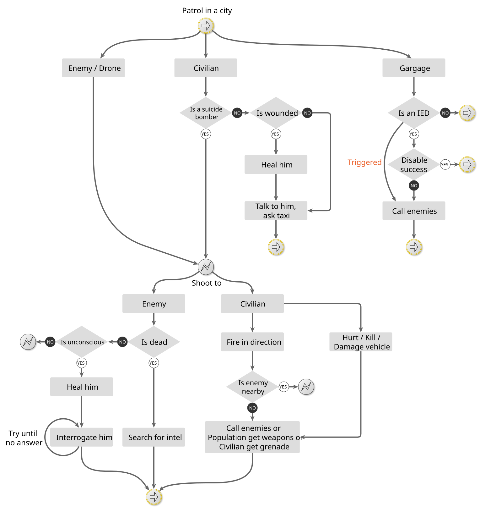

# Actions have consequences

The flowchart summarizes example interactions involving civilians, enemy patrols, wounded or unconscious people, intel, IEDs, and the garage. It is a high-level guide; the mission scripts determine the exact conditions and effects.

